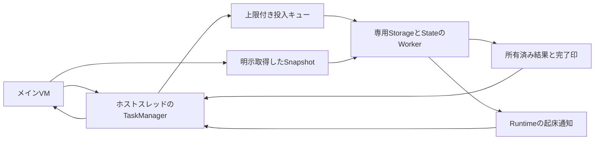

# 1048 システムのタスク制御：詳細計画

作成日：2026-11-23。対象：1048、配下1049〜1054。
状態：実装前に作成した詳細計画へ、利用者判断と進捗を追記した文書である。公開APIの提案と決定済み事項を区別する。
調査対象：HEAD `35523f6` のソースと、同日のtqueのタイトル・親子関係・直接依存。

本書は[補完計画](TASK_CONTROL_PLAN.md)を、具体的な試作・判断・実装・検証へ展開する。
既存の[詳細設計11節](CORE_EXTENSION_DETAILED_DESIGN.md#11-タスク制御10491054)、
[判断記録](CORE_EXTENSION_DESIGN_DECISIONS.md)、[State隔離監査表](CORE_EXTENSION_WORKER_STATE_AUDIT.md)と併読する。
2026-11-24の利用者決定を3・9.1・12.3・15・16節へ反映した。利用者決定と実装・実行結果を記載した箇所を除き、本書の方式・契約・構造は提案である。

## 1. 目的と初期版の到達点

メインVMが入力、描画、I/O、音の制御を続けながら、まとまった処理を投入し、
結果・失敗・取消し完了を受け取れる仕組みを作る。
初期版では「任意のForthプログラムをそのまま並列実行する」より、実行範囲と寿命を限定した計算ジョブを優先する案とする。

| 利用例 | メイン側の役割 | タスク側の役割 | 確認すること |
|---|---|---|---|
| ゲームの経路探索・マップ生成 | 入力とフレーム処理、新しい要求への差替え | コピーされた入力から結果を計算 | 古い要求の結果を適用しない、取消し後も応答が続く |
| TUIの検索・集計 | 入力、一覧表示、結果の取得 | バッファを検索・集計 | 結果が大きい場合の上限、通知の取りこぼしからの復旧 |
| I/Oと計算の連携 | 639のI/Oを進め、読み取ったデータを投入 | 許可された計算だけを実行 | 待機のために入力や出力の排出を止めない |

任意位置からの継続再開、敵対コードに対するセキュリティ境界、ハードリアルタイム保証は初期版の目的に含めない案である。
OSプロセスを隔離する643、OSのI/O補助スレッド、Forthタスクの寿命と状態を区別する。

## 2. 調査で確認した現在の基盤

以下は2026-11-23時点の確認結果であり、ワーカー実装の成立を示すものではない。

| 基盤 | 現状 | 1048で必要な追加判断 |
|---|---|---|
| 638 イベント | 完了。メインの標準入力状態と期限付き待機がある | 入力の所有をメインに保った複合待機 |
| 639 I/O | 完了。WAIT-FILES、READ/WRITE-AVAILABLE等がある | I/O状態をタスク終了・入力・期限と併せて待つ境界 |
| 643 プロセス | 完了。起動・標準ストリーム・終了・回収がある | 独立プロセス案で再利用できる部分とForth辞書転送の追加部分 |
| 652 実行制限 | 完了。ただしdebug専用 | 通常ビルドでのタスク取消しを別経路として成立させる |
| 1037 表示支援 | 完了 | 描画完了、表示先ごとの未対応、物理提示を区別した待機 |
| 共通Runtime | Clock、Deadline、WakeOps、Cancellation、型付き台帳がある | メイン所有の台帳とワーカーの通知・停止印の分離 |
| 1056・1064 | 語群基盤と共通基盤の受け入れは完了 | 追加するタスク機能の構成試験と所有権 |

根拠となる実装：
[VM](../src/forth.zig)、[共通契約](../src/core/runtime_base.zig)、
[ホストRuntime](../src/host_runtime.zig)、[起床](../src/host_wake.zig)、
[652](../src/core/execution_control.zig)、[イメージ復元](../src/core/image_restore.zig)、
[I/O実装記録](ASYNC_IO_IMPLEMENTATION.md)、[プロセス実装記録](PROCESS_MANAGEMENT_IMPLEMENTATION.md)。

### 2.1 既存の実行ループ

`executeOperations`は通常経路と、debug条件で有効になる数える経路を選択する。
`runOperations`にはCATCHの回復処理があり、`runOperationsLoop`の実行位置はループ内のローカル変数にも保持される。
したがって、Stateのフラグやスタックだけを保存すれば任意位置で再開できる、とは扱わない。
`halted`はBYEの状態であり、他スレッドからの取消し印に流用しない。

ソースで確認した構造は次のとおりである。

| 項目 | 確認結果 | 1048への影響 |
|---|---|---|
| 経路の選択 | `executeOperations`（`src/forth.zig:1850`）が入口ごとに`runOperations(self, comptime counted, ...)`を選ぶ。`counted=true`は`defs.debug_enabled`のときだけ選ばれ、通常ビルドでは`counted=false`の実体だけが使われる | ワーカー用の取消し確認は、同じcomptime引数の追加値として作れる。通常ビルドの`counted=false`の実体は変えずに済む候補がある |
| 入口の再選択 | コロン定義の呼出しは、多くの場合ループ内のフレームで進み、`executeOperations`を再入しない。再入するのは、`src/core`の15ファイル・22箇所にあるネイティブ処理からの`executeWord`呼出しと、ループ内の`wordInLoop`（`src/forth.zig:1754`）がDOES>等で`executeWord`へ戻る経路である | 経路の選択を局所変数でなくStateの印で決めれば、EXECUTE等の再入後もワーカー経路を保てる。652の`execution_control.active`と同じ型の判定である |
| 捕捉されない失敗 | `error.Quit`と`error.StepLimit`は、ループの回復処理（`src/forth.zig:1898`）と`CatchContext.handleError`（`src/core/words_system.zig:124`）の2箇所で捕捉対象から外される | 取消し専用の失敗値を追加する場合は、この2箇所に加える。上記の再入経路すべてについて、失敗を別の値やiorへ変換しないかも監査する |
| 1回の確認の費用 | 652の`charge`は、予算の入れ子が1段以上あるときだけホストへ問い合わせる。`.operation`では`poll_interval`=1024回に1回、`.native`・`.entry`では毎回である | ワーカーでは問い合わせではなくタスク固有の取消し印（`Cancellation`）を直接読む案とし、確認の単位と間隔は試作で決める |
| Stateの配置 | `words`・`code`・`names`はStateの固定長配列で、`memory`とスタック類は`Storage`の別確保である | ワーカー1件ごとにState全体とStorageを確保する。大きさは1049-Cで実測し、ワーカー数の上限D07の根拠にする |

### 2.2 監査表の差分

State直下のフィールド名をソースから列挙して既存表と比較した結果は、ソース176項目、監査表171項目だった。
表にない5項目は`gfx_clip`、`gfx_displays`、`gfx_window_fit`、`gfx_window_smooth`、`gfx_window_keep_open`。
1053のtqueタイトルにある「168項目」も現状と一致しない。
この比較は直下の名前の照合であり、コンテナ内部・ホスト参照・スレッド安全性の監査ではない。

1053ではこの差分を取り込み、Writerの新しい操作口、State内部のポインター、
ホストの共有変数、C/OSの共有状態まで再帰的に確認する。フィールド数を完了条件にはしない。

### 2.3 モジュール単位の共有状態

Stateの外にあるモジュール単位の変数（`var`・`pub var`の宣言行）は、テスト用を除いて16ファイルに255行ある。
`host_line.zig`の`sunk`はテスト専用のため数に含めない。
同じプロセス内の全VMが共有するため、ワーカーから到達させない対象である。

| 区分 | ファイル | 扱いの案 |
|---|---|---|
| コア | `src/core/event_input.zig`の`modern_depth`。`src/main.zig:3394`が参照する | コアで唯一確認された共有変数。ワーカーが入力語を使わない許可集合なら到達しないが、1053でState側への移動または到達不能の証明を選ぶ |
| 入出力・端末 | `main.zig`の出力バッファ・ファイル表・標準入力・行編集の履歴、`host_input.zig`、`host_resize.zig` | ワーカーのWriterから参照しない。`write_fn`は専用バッファへ接続する |
| 待機・信号 | `host_wait.zig`の`execution_machine`等、`host_signal_broker.zig` | メインVMだけが所有する。ワーカーの待機と取消しは`WakeOps`・`Cancellation`へ分ける |
| プロセス・音・表示・入力機器 | `host_process.zig`、`main.zig`のプロセス表、`host_audio.zig`、`host_display_*.zig`、`host_window_*.zig`、`host_gamepad.zig`、`host_evdev.zig`、`host_directories.zig` | 初期許可集合に含めない。到達経路はWriterの`process_ops`・`file_ops`等のcallbackで、ワーカーのWriterでは設定しない |
| Runtime | `host_runtime.zig`の`identities` | 世代とowner IDの発行元。タスク台帳もここから発行する案とし、ホストスレッドだけが更新する |

Writer（`src/core/host_interface.zig:186`）は`context`を含めて73フィールドを持ち、大半がcallbackと操作表である。
監査表には数だけでなくフィールド名を列挙し、追加されたフィールドを照合で検出できるようにする。
ワーカー用Writerは許可したcallbackだけを設定し、それ以外をnullにする。
ただし7.2のとおり、nullであることを禁止の唯一の根拠にしない。null時に別の既定動作へ落ちる語がないかを1049-Bで確認する。

## 3. 決定事項と提案の区分

| 区分 | 内容 |
|---|---|
| 既存の決定 | audio・graphics・extensionの独立選択、652のdebug専用、通常実行ループを変えない方針 |
| 実装上の前提 | メインの入力・表示・音・ファイル資源を、Stateの値コピーでワーカーへ共有しない |
| 本書の第一候補 | 制限付き独立Forth VM。取消し・隔離・費用の試作が合格した場合に限って採用判断へ進む |
| 比較対象 | 協調ジョブ、Zigジョブ限定、独立プロセス。継続保存も比較表に残す |
| 利用者の決定（2026-11-24） | Aを選ぶ。「命令ごとの定期取消し確認を通常経路へ加えないこと」だけを必須とする。入口判定、State配置、回復判定、サイズなど、それ以外の変化は改良後の差分を見てレモンが個別に判断する。通常経路の機械語不変は必須としない。 D01はW1改良・再評価とする。 |
| 初期制限・寿命の決定 | 初期拒否、新規VM、旧Snapshot、終端・RELEASE、所属・待機は15節の利用者判断に従う。利用条件案は1385で先に作成する |

第一候補を記載したことは、独立VMの採用承認ではない。
既存レビューで指摘された取消し・隔離の問題を、文書上の説明だけで解消済みにしない。

## 4. 1049の方式比較

| 方式 | 利点 | 制約 | 採用前の確認 |
|---|---|---|---|
| 小さな協調ジョブ | VMを共有でき、スナップショット転送が不要 | アプリが処理を分割して戻る必要がある。長い処理や同期I/Oでメインが止まる | 処理分割の現実性、1回の処理量、公平性 |
| Zigジョブ限定 | 実行経路と取消し点を限定しやすい | 計算を利用者のForthで書けない | 必要な処理を本当にこの範囲で表現できるか |
| 制限付き独立Forth VM | Forthの計算を別VMへ渡せる | 辞書・データ転送、権限制限、専用取消し経路が必要 | 停止・隔離・動的呼出し・初期化費用 |
| 独立プロセス | プロセス終了を停止境界にできる | 起動・IPC・辞書転送・回収が必要 | 643との接続、出力終端、停止と回収の費用 |
| 継続の保存・再開 | Forthの途中で待機・再開できる | 実行位置、CATCH、ローカル変数、Zig呼出しを含む設計が必要 | 保存可能な境界と、保存できないネイティブ処理の扱い |

初期比較では、協調ジョブを小さな処理の基準にし、独立Forth VMの成立を試す。
独立VMが隔離または取消しで不合格なら、ネイティブ限定・独立プロセスを再評価する。
代替方式へ自動的に決定せず、できなくなる利用例と費用を判断記録へ残す。
継続保存は初期版の必須条件にしない案とする。

### 4.1 採用を止める条件

- `debug=false`の無限ループを取り消せない。
- 入れ子のEXECUTE/CATCHやインライン展開から通常経路へ抜け、取消し・許可検査を回避できる。
- メインのメモリ、出力、入力、画像、音、ファイル、信号所有へ干渉する。
- 結果を回収する前に参照先が解放される、またはVM再利用で前の状態が残る。
- 起動・コピー・停止の費用が、採用前に決めた利用条件を満たさない。

## 5. 初期版のForthワーカー範囲案

第一段階は、辞書で定義済みの入口へ入力バイト列をコピーし、結果バイト列を回収する計算用途に限定する。
REPLの任意ソース文字列をそのままワーカーで解釈するAPIは初期案に含めない。

| 操作 | 初期案 |
|---|---|
| 算術・比較・分岐・ループ・スタック | 最小許可集合として監査する |
| ワーカー内の論理メモリ | 許可範囲と上限を検査して利用する |
| EXECUTE・CATCH・THROW | 初期版では許可しない。解除は機能ごとに別判断とする |
| 入力・表示・音・メインのファイル | 初期許可集合に含めない |
| SYSTEM・同期OS待機・コンパイル・辞書変更 | 初期許可集合に含めない |
| タスクの投入・タスク間の待機 | メインのみ。ワーカー間の同期待ちを初期版では作らない |
| メインVMのアドレス・実行トークン・資源ID | そのまま渡さない。対応する入口記述とコピーされたデータを使う |

入口のABI候補は`( input-addr input-len -- output-addr output-len )`とする。
これはワーカー内の呼出し規約の提案で、公開TASK語の確定したスタック効果ではない。
入力はワーカー自身のメモリに置き、正常終了時のスタック深さ、出力範囲、長さ、上限を検査してからコピーする。
結果がワーカー内の入力領域や静的データを指す場合も、コピー完了までVMを保持する。
負の長さ・不正アドレス・規約違反はタスク失敗として回収する。公開するエラー値は1050で決める。

## 6. 内部構造と所有権の案

| 対象 | 所有者・寿命 |
|---|---|
| タスク台帳 | ホストスレッドが更新する。既存ResourceTableをワーカーから直接変更しない |
| WorkerのStorage・State | 実行中はそのワーカーが所有する。停止・結果コピー・回収前に解放しない |
| Snapshot | 不変の保存データ。実行中の参照と外部参照がなくなるまで保持する |
| 入力 | 投入成功前にコピーを完了する。投入失敗時は呼出し側の所有を変えない |
| 結果・診断 | 上限付きの所有バッファ。メインへ戻すのはコピーまたは明示した所有権移転だけ |
| 取消しトークン | タスクごとに用意し、利用者が停止したことを確認してから破棄する |
| Runtimeの取消し | Runtime全体の終了用。1件の取消しで全体の取消し印を立てない |

ワーカーは自分の完了領域へ結果を書き、公開可能な状態にしてから起床を通知する。
台帳の状態変更と公開ハンドルの操作は所有ホストスレッドへ戻す。
キューのメモリ順序、完了領域の再利用、通知失敗時の回復は1050・1051の実装設計で証明・試験する。

## 7. Snapshotと隔離

### 7.1 取得・復元

候補は、メインの安全な境界で明示取得し、版を指定して投入する方式である。
取得後の通常変数の変更は反映しない。ワーカーの変更もメインへ自動で戻さない。
スナップショットの取得はメインを占有する可能性があるため、計算本体の並列化とは別に費用を測る。
初期案ではロード時などに取得して再利用し、処理中の毎フレーム取得を前提にしない。

新規Storageと`State.init`から開始し、Stateを値コピーしない。
`encodeImage`と`restoreFresh`を候補とするが、完全な実行状態のコピーとは扱わない。
メモリ形状、builtin数、保存範囲、ヒープ、再配置記録を検証し、復元後のspecialize/inline処理も含めて照合する。
実行中のスタック・継続・入力・OS資源を保存イメージから引き継がない。

### 7.2 許可検査

1. 復元・specialize・inline処理後の入口から到達可能な静的コードを検査する。
2. 直接のbuiltin Op、インライン展開された禁止語も検査対象にする。
3. 静的に解けない実行先はワーカー専用経路で検査する。最初の試作で動的呼出しを拒否する場合も、その拒否を試験する。
4. 専用Writerには必要なcallbackだけを渡す。null callbackだけで禁止を保証しない。
5. 必須write_fnはメイン出力へ接続せず、上限付きの専用バッファまたは明示した拒否経路にする。

### 7.3 寿命と再利用

実行中のタスクは投入時のSnapshotを保持する。
通常変数変更後も明示指定した旧Snapshotの投入を許す。FORGET・MARKER・完全復元後は旧版の新規投入を拒否し、実行中の版は最後まで保持する。最新値が必要なら利用者が再取得する。古い入口の検出方法はD03の後続で具体化する。
通常の`!`を監視したり、既存の`image_generation`を全変更の検出へ流用したりしない。

初期版はタスクごとに新規VM（Storage.allocate＋State.init）を基準とし、VM再利用（プール・省略初期化）は保留する。
省略による高速化は、全176項目とその後の追加項目、Writer、ホスト参照を分類し、
成功・失敗・取消し後の連続実行で漏れがないことを確認してから採用する。

## 8. 状態・結果・ハンドルの案

内部状態案は`created → queued → running ↔ waiting → succeeded / failed / cancelled`。
取消し要求は独立した印とし、要求しただけで`cancelled`にはしない。
`created`を外部へ公開する必要があるか、初期版の計算タスクに`waiting`を公開するかは1050で絞る。

- 投入は、入力確保とキュー登録が成功して初めてハンドルを返す。
- 終端状態は一度だけ確定する。確定後の取消し要求で結果を変更しない。
- 実行結果で一度だけ終端を確定する。要求だけで取消しにせず、要求済みでも正常帰還なら成功し得る。競合の具体的な順序をD04の後続で再現試験へ落とす。
- 結果の照会は消費しない案とする。容量不足では必要量を返し、再取得できる。
- 通知は状態を読みに行くきっかけであり、結果そのものの唯一の保管場所にしない。
- ハンドルは型・所有者・世代を検査する。解放したIDを別のタスクに誤適用しない。
- バッファ満杯・台帳満杯・キュー満杯を別の原因として診断できるようにする。

2026-11-24の利用者判断により、実行中の`TASK-RELEASE`は外部ハンドル無効化と取消し要求を行い、実行側参照を保持する。切離しは行わず、停止不能時は解放せず診断する。結果破棄の時点と所有者の回収手順はD05の後続で具体化する。

## 9. 取消しと通常ビルド

独立Forth VM案では、通常のメイン経路と別に、取消し確認を含むワーカー用のコンパイル経路を候補とする。
通常ビルドのdebug機能を有効化したり、通常の全操作へ無条件のatomic読取りを足したりしない。
動的なStateフラグだけで、既に走っている通常ループを切り替えたことにしない。

取消しの契約案は次の順序である。

1. 所有者がタスク固有の要求をラッチし、必要なら待機を起こす。
2. ワーカーが許可された安全な境界で要求を確認する。
3. CATCHで通常のForthエラーとして握り潰されない経路で入口から戻る。
4. 完了と競合しない形で終端を確定し、結果・診断と所有資源を回収する。
5. メインへ通知し、参照がなくなったStorage等を解放する。

確認地点を持たないネイティブ処理や同期OS呼出しについて、有限時間の停止を保証しない。
共有メモリを操作するスレッドを強制終了して回収成功にはしない。
停止不能時は参照対象を解放せず、診断とホスト終了の経路を定義する。
初期許可集合を狭くする理由の一つは、この停止不能経路を通常利用で作らないことである。

### 9.1 ワーカー実行経路の実装候補（D01の検討材料）

1352〜1356の試作・比較を踏まえ、2026-11-24に利用者はW1改良案(b)を選んだ。1384（タスク制御04-0、親1052）で改良し再評価する。方式の確定と公開は保留する。W2・W3は再比較候補である。

| 案 | 内容 | 通常ビルドのメイン経路への影響 | 主な懸念 |
|---|---|---|---|
| W1 独立したcomptime引数 | 既存の`counted: bool`とは別に`worker: bool`を`runOperations`へ加え、`worker=true`の実体だけが一定操作ごとに`Cancellation`を読む | 1355で入口判定・State配置・回復判定・生成コードの変化を確認した。定期取消し確認を通常経路へ加えず、他の変化は改良後に個別判断する | 入口1回あたりの分岐費用。ループ本体の生成コードが変わらないことを逆アセンブルの比較で確認する。サイズの一致だけでは不変の証明にしない |
| W2 ワーカー専用ビルド構成 | ワーカーだけ別のbuild optionで`worker`経路を含める | メインの実行体は無変更 | 現行コードは単一の`forth.State`型を前提にしており、別構成の実行体を同一プロセスへ組み込むには追加設計が必要である。可否は未検討 |
| W3 Stateの型を分ける | ワーカー用のState型をcomptimeで生成する | 無変更 | コアの語実装が`*forth.State`を前提にしており、型の分離は全語に波及する。比較のために残すが試作の第一候補にしない |

W1の改良・再評価では次を扱う。これは今回の実装・測定指示ではない。

1. executeWord／executeOperationsの選択位置、State文脈の保持方法・配置、workerの拒否検査、TaskCancelledの回復除外を見直す。
2. 外側CATCHへの取消し伝播、再入・inline・specialize後の取消しと許可検査を維持する。
3. 命令ごとの定期取消し確認を通常経路へ加えないことだけを必須とする。機械語不変は必須とせず、入口判定・State配置・回復判定・サイズは改良後の差分を見てレモンが個別に判断する。
4. workerのcounted（652予算・trace・profile・step）は初期版では許可しない。動的実行・例外・PAD・境界未検証のDO系も15節の初期制限に従う。BEGIN系は許す。
5. 追加測定の要否は1385で利用条件案を作成した後に判断する。改良の成立や通常側の差分の許容を先に確定しない。

根拠は[方式判断8節](TASK_CONTROL_METHOD_DECISION.md)と[利用者の決定](CORE_EXTENSION_DESIGN_DECISIONS.md)である。

## 10. スケジューリングと複合待機

メインの入力、I/O、完了処理、描画を一巡ごとの上限付きで進める。
優先度やプリエンプションは初期必須にせず、投入順と公平性を試験する。
すべてのワーカーが他タスクの結果を待ち、後続の仕事が走らなくなる構造は初期版で禁止する案とする。

複合待機の対象案は入力、I/O可用、タスク終端、単調時計の期限、利用可能な描画完了である。
既存のWAIT-FILESやWINDOW-PAINT-WAITを順番に呼ぶだけでは、1つ目が他の条件を止めるため代用にならない。
各供給元の状態と通知を、共通の待機登録へ接続する必要がある。

手順案は「起床世代を観測 → 対象を登録 → 条件を再確認 → 単一期限まで待機 → 条件を再取得」。
登録前・登録直後・解除中の成立、複数条件の同時成立、取消しと期限の競合を検証する。
既に成立した条件は待機せず返す。通知が併合されても現在状態から回復できるようにする。

フレームについては、描画完了の番号、次の処理時刻、物理的な画面提示を混同しない。
VSYNC-WAITは窓のある画面専用の垂直同期ではなく、Tk等の未対応経路もある。
描画完了を待機対象にするなら、対象番号、backendの能力、close時の終端を登録時に検査し、
未対応のまま永久待機する契約にしない。

## 11. 公開APIの検討単位

2026-11-24にレモンは[公開APIの決定9節](TASK_CONTROL_PUBLIC_API_PROPOSAL.md#9-利用者の回答2026-11-24)の問1〜10すべてで推奨案（A）を採用した。ハンドル、エラー値、状態、入口ABI、スタック効果、複合待機のレコード配置、語名とworker制限の表示方針は同書2〜6節の契約に従う。1379の実装と試験は完了した。APIの決定と実施結果は区別し、実施結果は[1379の実装記録](TASK_CONTROL_IMPL_1379.md)に従う。

| 公開操作 | 決定した契約の対象 |
|---|---|
| Snapshot取得・解放 | 取得する辞書とデータ、同時保持数、取得中の一貫性、世代と寿命 |
| TASK-SUBMIT | Snapshotと入口の指定、入力コピー、失敗時の所有権、キュー満杯 |
| TASK-STATE | 現在状態、取消し要求、結果サイズ、診断、非消費の照会 |
| TASK-CANCEL | 要求と停止完了の区別、終端後の操作、競合規則 |
| TASK-WAIT | 対象の終端、期限、割込み、複合待機との関係 |
| TASK-RESULT | バイト列の取得、容量不足、再取得、失敗・取消し時の扱い |
| TASK-DIAGNOSTIC | 主・副・Writer障害・回収診断の非消費取得、容量不足 |
| TASK-RELEASE | 外部参照の解放、実行側参照、古いハンドル、未終了時の扱い |
| TASK-WAIT-MANY | 対象型、登録・解除、返す成立条件、同時成立、対象寿命 |

所属はD06で決定済みのEXTENSIONとする。graphics/audioから自動でextensionを有効化しない。
graphics単独構成でタスク語を使う場合は明示的に併用し、公開語群と内部Runtimeの再利用を区別する。決定した公開表現は[公開APIの決定](TASK_CONTROL_PUBLIC_API_PROPOSAL.md)に示す。

## 12. 子タスクごとの作業と成果物

| 順序 | tque | 作業・成果物 | 完了の判定 |
|---|---|---|---|
| 1 | 1049-A | 利用例、非目標、5方式の比較、既存レビューR01〜R03/F01〜F03の対応表 | 採用基準と未決事項が明文化されている |
| 2 | 1049-B | 最小許可語の到達先・ホスト参照監査（12.2） | 試作が触る範囲が特定され、未監査の処理へ進まない |
| 3 | 1049-C | 取消し・隔離・Snapshotの試作と測定 | 4.1の停止条件を通過し、代替案と費用を比較できる |
| 4 | 1049-D | 方式判断、通常ループ方針との整合、設計レビューと対応 | 採用・保留・不採用の根拠を区別して記録する |
| 5 | 1053・1050・1051・1052 | 1049の後に並行して開始する。各子タスクの間の依存で順序を保つ（12.1・12.3） | 下の各行 |
| ― | 1053 | State/Writer/共有状態の再帰監査、Snapshot復元、許可検査、VM再利用 | メイン干渉と許可検査の迂回がなく、各終了条件後に再利用できる |
| ― | 1050 | 状態機械、ハンドル、上限、結果・エラー、解放 | 競合、満杯、古いID、結果の再取得を再現可能に検証する |
| ― | 1051 | スケジュール、待機登録、供給元の接続、公平性 | 起床取りこぼし、飢餓、逆圧、循環待機を検証する |
| ― | 1052 | 取消し、所有者終了、QUIT/BYE、辞書復元、回収期限 | 二重解放・残存・解放後参照がなく、不能時の診断も確認する |
| 並行→最後 | 1054 | 受け入れ表、利用例、構成・OS試験、英語HELPと英日全語リファレンス | 全実装との結合後にのみ完了とする |

1049の試作前監査と1053の本監査を区別する。1053が1049を待つことを理由に、未監査のVMを先に並列実行しない。
1053で隔離・停止が不成立なら1049の方式判断へ戻る。

### 12.1 直接依存の確認

2026-11-23に依存を見直した。
従来は親タスクを1053→1050→1051→1052の直列でつないでいた。
しかし、実際に前段を必要とするのは各親の一部の子タスクだけである。
例えば1050の状態機械の仕様（1363）は1053の実装を必要とせず、1052の取消し実装（1373）は1051の複合待機を必要としない。
このため、親どうしの依存は1049と共通基盤への依存だけにし、前段の成果を使う子タスクへ直接依存を移した。

| タスク | 直接依存（見直し後） | 見直し前 |
|---|---|---|
| 1049 | なし | 同じ |
| 1053 | 1049、1056、1064 | 同じ |
| 1050 | 1049、1064 | 1053を含んでいた |
| 1051 | 638、639、1043、1049、1064、1091、1094、1095 | 1050を含み、639を含んでいなかった |
| 1052 | 1049、1064 | 1050・1051を含んでいた |
| 1054 | なし。実装結合前には完了しない | 同じ |

親から子へ移した依存は次のとおりである。

| 子タスク | 追加した直接依存 | 理由 |
|---|---|---|
| 1365（02-C 結果と診断） | 1361（05-D 入力・結果の転送） | 結果バッファはワーカーからの結果コピーの規約に従う |
| 1366（02-D 投入キューと完了領域） | 1358（05-A State再帰監査） | ワーカーと共有する完了領域の安全性は監査結果を前提にする |
| 1362（05-E VM再利用） | 1360（05-C 許可検査）、1361（05-D 入力・結果の転送） | 再利用後に入力・結果・許可検査の状態が残らないことを実装に対して確認する |
| 1367（02-E 状態の再現試験） | 1362（05-E VM再利用） | 解放と再利用の競合を試験する |
| 1368（03-A 待機登録の設計） | 1363（02-A 状態機械の仕様） | 待機対象のタスク終端の定義を使う |
| 1369（03-B 入力・I/O・期限の接続） | 1366（02-D 投入キューと完了領域） | タスク終端の起床通知を待機登録へ接続する |
| 1373（04-A 取消しの実装） | 1363、1366 | 終端の競合規則D04と、完了領域への終端確定を使う |
| 1374（04-B 終了時の回収） | 1364（02-B 台帳）、1368（03-A 待機登録） | 台帳からの回収と、取消し時の待機解除を扱う |
| 1376（04-D 回収の再現試験） | 1362（05-E VM再利用） | 05-Eは試作の取消し経路で行うため、本実装の取消し後の再利用をここで再検証する |
| 1379（06-C 公開語と文書）、1380（06-D 利用例と結合試験）、1381（06-E 構成試験） | 1050〜1053 | Snapshot取得・解放を含む全実装と結合してから行う |

1053→1064（1056経由でも満たされる）や1051→638・639のように推移的に重なる依存は、接続先を明示するために残す。

このほか、1049配下では1356（01-C5 時間の測定）から1355（01-C4）への依存を外し、1357（01-D 方式判断）が両方を待つ形にした。
04-Aが1352（W1試作）の結果を使う点は、親1052が1049を待つことで満たされる。引き継ぐ内容は1373の備考に記録した。
1354（01-C3 Snapshot試作）は復元とコードの照合までを対象とし、復元したコードの実行は1353（C2）で扱うため、1351（B3）への依存は付けない。

638・639・1043・1056・1064・1091・1094・1095は調査時点で完了済み。1048配下が全件未完了だったのは2026-11-23の調査時点であり、現在の進捗は12.3節に記す。

### 12.2 1049-Bの監査項目

試作が触る範囲を、次の単位で表にする。各行に「到達する」「到達しない（根拠）」「許可集合から外す」のいずれかを記録する。

| 単位 | 確認内容 |
|---|---|
| 許可するbuiltin | 最小許可集合の各語について、実装関数から到達するStateフィールド、Writerのcallback、モジュール変数 |
| `executeWord`の再入経路 | ネイティブ処理の22箇所と`wordInLoop`。許可集合から到達するか、失敗値を変換するか |
| specialize・inline後のOp種別 | `primitiveBuiltin`等で直接実行されるOpが、許可集合外の語を含まないか |
| Writerの73フィールド | フィールド名ごとに、ワーカーで設定するもの、nullにするもの、null時に既定動作へ落ちる語 |
| モジュール変数の16ファイル | 2.3の区分ごとに、許可集合から到達しないことの根拠 |
| 復元処理 | `restoreFresh`の`apply`が触るホスト資源（`graphics_images.releaseAll`、`physical_key_ops.reset`、Tclのヒープ）をワーカーで呼ばない、または無害であること |

最後の行は、`src/core/image_restore.zig`の`apply`が後始末として`graphics_images.releaseAll`、`physical_key_ops.reset`、`tcl.forgetHeap`を呼ぶためである。
ソース上の条件は次のとおりである。

- `releaseAll`は、そのState自身の画像スロットのうち空でないものだけを解放する。新規のワーカーStateではスロットが空なので、ホストの解放callbackは呼ばれない。
- `forgetHeap`はgraphics有効時だけ呼ばれ、ホストのTclヒープではなく、State内の論理ヒープへの参照を破棄する。
- `physical_key_ops.reset`は操作表がある場合だけ呼ばれる。ワーカーのWriterでは操作表をnullにする。

`restoreFresh`は、Storageが新規で0初期化済みであることを前提にメモリの消去を省略する（`src/core/image_restore.zig:51`）。
使用済みStorageへ適用すると、保存対象外の以前のデータが残る。
VM再利用（7.3）では、`restoreFresh`を新規確保のStorageに限り、再利用時は消去を行う`restore`を使うか、全領域を消去してから適用する。
再利用時に画像スロットが空でない状態から復元する場合も試験する。

### 12.3 詳細タスクと並行グループ

2026-11-23に、1049〜1054の配下へ詳細タスク1348〜1383を登録した。
同じグループのタスクは互いに依存せず、並行して進められる。
グループは、直接依存（12.1）をたどったときの段の深さで分けた。
開始の条件は、そのタスクの直接依存をすべて列挙したものである。
親の依存によるものは「親」と記す。

| グループ | 並行して進めるタスク | 開始の条件 |
|---|---|---|
| G1 | 1348（01-A 方式比較・レビュー対応表）、1349（01-B1 再入経路）、1350（01-B2 共有状態）、1351（01-B3 最小許可集合）、1377（06-A 受け入れ表）、1378（06-B 構成マトリクス計画） | なし。現在着手できる |
| G1相当 | 1385（タスク制御06-0 D07利用条件案、親1054） | 依存なし。すぐ着手可 |
| G2 | 1352（01-C1 W1試作）、1353（01-C2 最小隔離）、1354（01-C3 Snapshot） | 1352は1349・1351、1353は1350・1351、1354は1350 |
| G3 | 1355（01-C4 生成コード・サイズ比較）、1356（01-C5 時間の測定） | 1355は1352、1356は1352〜1354。1356は利用者の確認後に行う |
| G3の後 | 1357（01-D 方式判断） | 1348・1355・1356。利用者判断を含む。2026-11-24に回答済みだが、1357の全ゲート通過ではない |
| G4 | 1358（05-A State再帰監査）、1359（05-B Snapshot実装）、1360（05-C 許可検査）、1361（05-D 入力・結果の転送）、1363（02-A 状態機械の仕様）、1384（タスク制御04-0 W1改良・再評価、親1052） | 1358〜1361は親1053の依存（1049・1056・1064）、1363は親1050の依存（1049・1064）、1384は親1052の依存（1049・1064）のみ。1384は1373の前提 |
| G4の後 | 1386（タスク制御04-0b W1改良の最終受入れ、親1052） | 1384に依存する。2026-11-24に測定記録に基づいてレモンが最終受入れを決定し、完了済みである |
| 任意の後追い | 1388（解釈実行の入口のスレッドローカル検索の削減、親1048） | 1386で受入れ済み。必要になった時点で着手し、測定前にレモンへ確認する |
| G5 | 1362（05-E VM再利用）、1364（02-B 台帳とハンドル）、1365（02-C 結果と診断）、1366（02-D 投入キューと完了領域）、1368（03-A 待機登録の設計） | 1362は1358〜1361、1364は1363、1365は1361・1363、1366は1358・1363、1368は1363（親の依存に加えて） |
| G6 | 1367（02-E 状態の再現試験）、1369（03-B 入力・I/O・期限）、1370（03-C 描画完了）、1371（03-D スケジューリング）、1373（04-A 取消しの実装） | 1367は1362・1364〜1366、1369は1366・1368、1370・1371は1368、1373は1363・1366・1384 |
| G7 | 1372（03-E 待機の再現試験）、1374（04-B 終了時の回収）、1375（04-C 停止不能時の扱い） | 1372は1369〜1371、1374は1364・1368・1373、1375は1373 |
| G8 | 1376（04-D 回収の再現試験） | 1362・1374・1375 |
| G9 | 1379（06-C 公開語と文書）、1380（06-D 利用例と結合試験）、1381（06-E 構成試験の実行） | 1379は1050〜1053の完了、1380は1050〜1053の完了、1381は1050〜1053の完了と1378 |
| G10 | 1382（06-F Windows・Linux（WSL）実機）、1383（06-G macOS実機） | 1377・1379〜1381。機械が異なるため並行可 |

2026-11-24に `tque show` で、1049〜1053とその全子（1348〜1376、1384、1386、1387）、および1385の完了を確認した。1388（親1048）は未完了の任意の後追いであり、1379（親1054、依存1050〜1053）は同日の `tque show` で完了を確認した。1380（親1054、依存1050〜1053）と1381（親1054、依存1050〜1053・1378）は未完了である。公開APIの問1〜10はすべて推奨案（A）で決定済みであり、描画kind=5とHELP表示の追加判断は[判断記録](CORE_EXTENSION_DESIGN_DECISIONS.md)に記す。上表のグループは登録時の依存段階を示し、現在の未完了一覧ではない。

1379の実装と試験は完了した。Windowsでは `test`・`test -Ddebug=false`・`runtime-test`・代表構成・クロスビルド・文書検査、Linuxの機械では `runtime-test`・`test`・`test -Ddebug=false`・`-Dx11=false`・ForthのABI試験を終えた。根拠は[1379の実装記録](TASK_CONTROL_IMPL_1379.md)とレモンの報告である。次の着手は1380（利用例と結合試験）と1381（構成試験の実行）であり、1379の検証を両タスク全体の完了とは扱わない。

レモンは1386でW1改良（1384）の通常経路の変化を最終的に受け入れた。根拠は[1386の測定記録](TASK_CONTROL_MEAS_1386.md)である。W1なしの基準 `35523f6` と比べ、測った4負荷の中央値増加は最大約+0.46%（原値+0.462%）であり、起動時間・サイズも目安内である。入口判定そのものの費用は配置の影響（±3〜4%）と切り分けられず、INTERPRETのB/A′は中央値+2.329%（約+2.3%）であった。配置の寄与率・判定単独の費用を確定したとは扱わない。測定記録の統計上の「判定不能」や未確認事項を残した上での利用者判断である。

解釈実行経路の検索削減は1388の任意の後追いとし、1379の開始条件には追加しない。今回の文書更新では測定・試験を再実行していない。公開APIの決定と各問の回答日は[公開APIの決定](TASK_CONTROL_PUBLIC_API_PROPOSAL.md)に記録した。APIの決定と実装・検証の進捗を区別する。

G4〜G7には1050〜1053の子タスクが混在する。各グループ内に同じファイルを変更するタスクがあり得るため、変更範囲が重なる場合は順に進めて衝突を避ける。
実機受け入れは1台の機械で1回に行える単位に分け、WindowsとWSLのLinuxを1382、macOSを1383とした。

## 13. 必須の検証項目

以下は受入れ条件であり、本書作成時に合格したという意味ではない。2026-11-25のAC-01〜AC-29のOS別判定・根拠・未確認の担当は[受入れ総括](TASK_CONTROL_ACCEPTANCE_SUMMARY.ja.md#ac-verdicts)（[English](TASK_CONTROL_ACCEPTANCE_SUMMARY.md)）を参照する。

| 分類 | ケース | 合格条件 |
|---|---|---|
| 通常ビルド | debug=falseで計算・無限ループを実行して取消す | debug経路へ依存せず停止し、メインの応答が続く  [最新判定](TASK_CONTROL_ACCEPTANCE_SUMMARY.ja.md#ac-verdicts) |
| 実行文脈 | 入れ子、EXECUTE、CATCH、最適化されたOp | 許可する場合も取消しと権限検査が維持され、拒否する場合は実行前または実行境界で拒否する  [最新判定](TASK_CONTROL_ACCEPTANCE_SUMMARY.ja.md#ac-verdicts) |
| 隔離 | ワーカーが変数・ヒープ・出力を変更する | メインと他タスクのデータ・出力へ混ざらない  [最新判定](TASK_CONTROL_ACCEPTANCE_SUMMARY.ja.md#ac-verdicts) |
| 禁止語 | 入口内部・インライン・動的行先にUI/SYSTEM等 | callbackのnullだけに依存せず拒否される  [最新判定](TASK_CONTROL_ACCEPTANCE_SUMMARY.ja.md#ac-verdicts) |
| Snapshot | 取得後の変数更新、辞書変更、古い入口 | 決めた版と失効規則どおりに動く  [最新判定](TASK_CONTROL_ACCEPTANCE_SUMMARY.ja.md#ac-verdicts) |
| 結果 | 0バイト、上限、容量不足、不正な結果範囲 | 境界を検査し、再取得と失敗が契約どおりになる  [最新判定](TASK_CONTROL_ACCEPTANCE_SUMMARY.ja.md#ac-verdicts) |
| 状態競合 | 完了・失敗・取消し・解放の競合 | 終端が一度だけ確定し、二重通知・二重解放しない  [最新判定](TASK_CONTROL_ACCEPTANCE_SUMMARY.ja.md#ac-verdicts) |
| 台帳 | 満杯、世代枯渇、別種ID、古いID | 別タスクへ操作が届かず、失敗時に入力を奪わない  [最新判定](TASK_CONTROL_ACCEPTANCE_SUMMARY.ja.md#ac-verdicts) |
| 通知 | 通知併合・通知失敗・通知だけ取りこぼす | 状態と結果から回復できる  [最新判定](TASK_CONTROL_ACCEPTANCE_SUMMARY.ja.md#ac-verdicts) |
| 複合待機 | 登録前後・解除中の成立、同時成立 | 起床を取りこぼさず、対象を解放後に参照しない  [最新判定](TASK_CONTROL_ACCEPTANCE_SUMMARY.ja.md#ac-verdicts) |
| 公平性 | 入力・I/O・完了通知の連続発生 | 一つの供給元が他を無期限に占有しない  [最新判定](TASK_CONTROL_ACCEPTANCE_SUMMARY.ja.md#ac-verdicts) |
| 回収 | 成功・失敗・取消し後の連続再利用 | State、Writer、入力、結果、Snapshot参照が漏れない  [最新判定](TASK_CONTROL_ACCEPTANCE_SUMMARY.ja.md#ac-verdicts) |
| 終了 | QUIT/BYE、所有者終了、完全復元 | 定義した順序で停止・回収し、活動中の復元を安全に拒否できる  [最新判定](TASK_CONTROL_ACCEPTANCE_SUMMARY.ja.md#ac-verdicts) |
| 結合 | 長い計算とI/O中に入力・描画を続ける | 応答と結果が保たれ、古い計算結果を新しい画面へ誤適用しない  [最新判定](TASK_CONTROL_ACCEPTANCE_SUMMARY.ja.md#ac-verdicts) |
| 構成 | debugなし、extensionなし、graphics/audio/files等の代表構成 | 語の有無と内部依存が既存の独立選択を壊さない  [最新判定](TASK_CONTROL_ACCEPTANCE_SUMMARY.ja.md#ac-verdicts) |

偽時計・偽起床・キュー操作で順序を制御する試験と、実際のOS資源・画面・端末で行う試験を分ける。
Windows・Linux・macOSはそれぞれ実行範囲を記録し、クロスコンパイルを実機合格と扱わない。
1037で利用者が不要としたDwmFlush非対応実環境テストを、1048の完了条件として再追加しない。

## 14. 測定計画と上限値

速度・時間の測定は、実施前に利用者へ確認し、他のアプリケーションを止めてもらってから行う。本書では測定項目を定義するだけで、測定は行っていない。
State・Storageの大きさやバイナリサイズのように時間を伴わない値は、この確認の対象外として扱う。
2026-11-24にD07の[利用条件](TASK_CONTROL_USAGE_CONDITIONS.md)10節の問1〜8で推奨案（A）を採用した。worker 1、追加128 MiB（同4節の内訳）、台帳16件、Snapshotは1版4 MiB・3本まで、確認点なしnative 64 KiB/回以下、要求→停止10 ms以内・要求→回収100 ms以内を利用条件とする。入力・結果・診断バッファ等の内訳も同書3〜6節に従う。
利用条件の決定は性能保証・受け入れ合格の記録ではない。追加測定は未実施であり、同書8節の手順で条件を先に固定し、実行は毎回、事前に利用者へ確認する。

| 測定対象 | 記録する値・条件 |
|---|---|
| VMの新規作成 | State/Storageの大きさ、予約量と実使用量、初期化時間、冷時・再利用時 |
| Snapshot | 保存対象、転送バイト数、取得時間、復元・再配置・許可検査の時間 |
| 投入と結果 | 入力サイズ別のコピー、待ち時間、キュー滞留、結果取得時間 |
| 取消し | 要求→確認→停止→回収の各時間。通常Forthと許可ネイティブを区別 |
| 応答 | 入力処理の遅れ、フレーム処理間隔、取りこぼし、逆圧時の進行 |
| 既存への影響 | 同じ設定の変更前後で単一VM実行、起動時間、バイナリサイズを比較 |

実行体・ソースのSHA-256、Zig版、最適化、CPU設定、OS、入力、ウォームアップ、反復数、測定順を結果へ残す。
中央値、p95、観測最大値と生データを保存する。観測最大値を保証上限とは呼ばない。
合格閾値は測定結果を見て都合よく変えるのではなく、利用条件を決めてから設定する。
通常運転は60 Hz・タスク管理のメイン占有1 ms/巡以下とし、ロード中のSnapshot取得はメイン占有50 ms以内・取得開始→投入可能100 ms以内として、通常運転と分ける。通常経路の時間・サイズの目安と個別判断は利用条件7節・10節に従い、目安内でも自動承認しない。

## 15. 利用者判断と後続で具体化する事項

2026-11-24の当初の利用者判断である。方式の確定と公開は保留し、1357の全ゲート通過とはしない。D01に対する1386での最終受入れと現在の進捗は12.3・16節に追記した。

| ID | 利用者の判断・詳細化の方針 | 後続の担当 |
|---|---|---|
| D01 | (b)を選び、W1を改良して再評価する。改良は1384（タスク制御04-0、親1052）で行い、1373（04-A 取消しの実装）は1384を前提とする。現行W1の無変更採用ではない。 Aを選ぶ。「命令ごとの定期取消し確認を通常経路へ加えないこと」だけを必須とする。入口判定、State配置、回復判定、サイズなど、それ以外の変化は改良後の差分を見てレモンが個別に判断する。通常経路の機械語不変は必須としない。 | 1384・利用者判断 |
| D02 | 制限付き独立Forth VMを第一候補として残す。方式の確定と公開は保留し、S02〜S05の未解消点とS04の代替手順を後続で検証する。不成立なら方式比較へ戻す。1357の全ゲート通過ではない。 | 1049・後続検証 |
| D03 | 通常変数変更後も、明示指定した旧Snapshotでの投入を許す。FORGET・MARKER・完全復元後は旧版の新規投入を拒否し、実行中の版は最後まで保持する。最新値が必要なら利用者が再取得する。 | 1359・1364・1374 |
| D04 | 実行結果で一度だけ終端を確定し、確定後は不変とする。要求だけで取消しにしない。正常帰還は成功し得る。 | 1363〜1367・1373〜1376 |
| D05 | 実行中RELEASEは外部ハンドル無効化＋取消し要求＋実行側参照保持とする。停止不能時は解放せず診断し、切離しなしとする。 | 1363・1364・1374・1375 |
| D06 | EXTENSION所属、graphics単独時は明示併用とする。-282は公開値として確定しない。公開表現・ABIは後続で具体化する。 | 1363〜1365・1379・1381 |
| D07 | 2026-11-24に1385（タスク制御06-0、親1054）の[利用条件10節](TASK_CONTROL_USAGE_CONDITIONS.md)問1〜8で推奨案（A）をすべて採用した。3〜6節の処理量・頻度・期限・資源上限、7節の通常経路の目安と個別判断、8節の追加測定手順に従う。性能保証・受け入れ合格の記録ではなく、追加測定は未実施である。実行は毎回、事前に利用者へ確認する。 | 決定済み利用条件に基づく後続検証 |
| D08 | 入力・I/O可用・タスク終端・単調時計期限を基準とする。描画完了は能力のあるbackendに限る。 | 1368〜1372 |

初期版の制限：動的実行（EXECUTE・.execute・.local_execute・DEFER・DOES>）、例外（CATCH/THROW）、workerでのcounted（652予算・trace・profile・step）、PAD、境界未検証のDO系（DO・LOOP・+LOOP・I・J・LEAVE・UNLOOP）は許可しない。解除は機能ごとに別判断とする。BEGIN系は許す。

VMの基準：初期版はタスクごとに新規VM（Storage.allocate＋State.init）を基準とする。VM再利用（プール・省略初期化）は保留する。

根拠は[方式判断8節](TASK_CONTROL_METHOD_DECISION.md)、[判断記録](CORE_EXTENSION_DESIGN_DECISIONS.md)および試作報告1352〜1356である。

判断記録には、採用案、比較した代替、根拠、未確認の範囲、取り消す条件、利用者判断を残す。
レビュー原文、指摘への評価、採否、反映後の設計を分けて保存する。
第三者のコードや方式を実装へ取り込む場合は、一次資料とライセンスを確認し、出典を記録する。

## 16. 次の着手と1048の完了条件

1379（タスク制御06-C 公開語の確定と文書）は、2026-11-24の `tque show` で完了を確認した。公開APIの実装・文書反映と試験は完了しており、Windows・Linuxの機械での検証範囲は12.3節と[1379の実装記録](TASK_CONTROL_IMPL_1379.md)に記す。

次の着手は1380（利用例と結合試験）と1381（構成試験の実行）である。両タスクは同日の `tque show` で未完了を確認した。1380では経路探索・TUI検索の例、長い計算とI/O中の入力・描画継続、古い結果の誤適用防止を扱う。1381では06-Bの構成マトリクスをWindowsとWSLのLinuxで実行し、既存の独立選択を保つことを確認する。1379で実施した代表構成等の検証と、これから行う結合・構成試験の範囲を区別する。

1386では、[測定記録](TASK_CONTROL_MEAS_1386.md)を根拠にレモンがW1改良の通常経路の変化を最終的に受け入れた。基準 `35523f6` に対する4負荷の中央値増加は最大約+0.46%（原値+0.462%）で、起動時間・サイズも目安内である。入口判定そのものの費用は配置の影響（±3〜4%）と切り分けられなかった。INTERPRETのB/A′約+2.3%を判定単独の費用とは扱わない。解釈実行経路の検索削減は1388の任意の後追いであり、必要になった時点で着手する。

1385のD07利用条件と、1386の通常経路の受入れは決定済みである。これらと1049〜1053のタスク完了を、1054の結合・構成・OS確認の完了や、方式全体の公開決定とは扱わない。未確認範囲は各実装記録・受け入れ表で追跡する。今回行ったのは公開APIの決定と進捗の記録であり、git操作、tque変更、測定、src/の変更は行っていない。

1048の完了は、方式採用だけではなく、1050〜1053の実装、1054の結合・構成・OS確認、
文書とHELPの整合、および全子の完了が揃った時点とする。
未採用になった仕組みは、その理由と利用上の制約を記録してからタスク範囲を更新する。
未実施の試験を合格とせず、利用者が対象外とした条件は実施済みではなく完了条件の変更として記録する。
